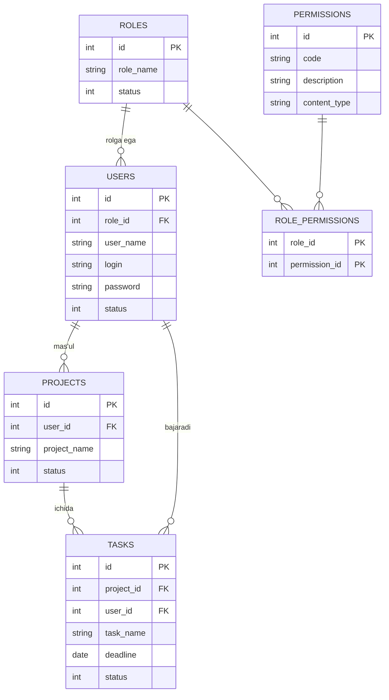
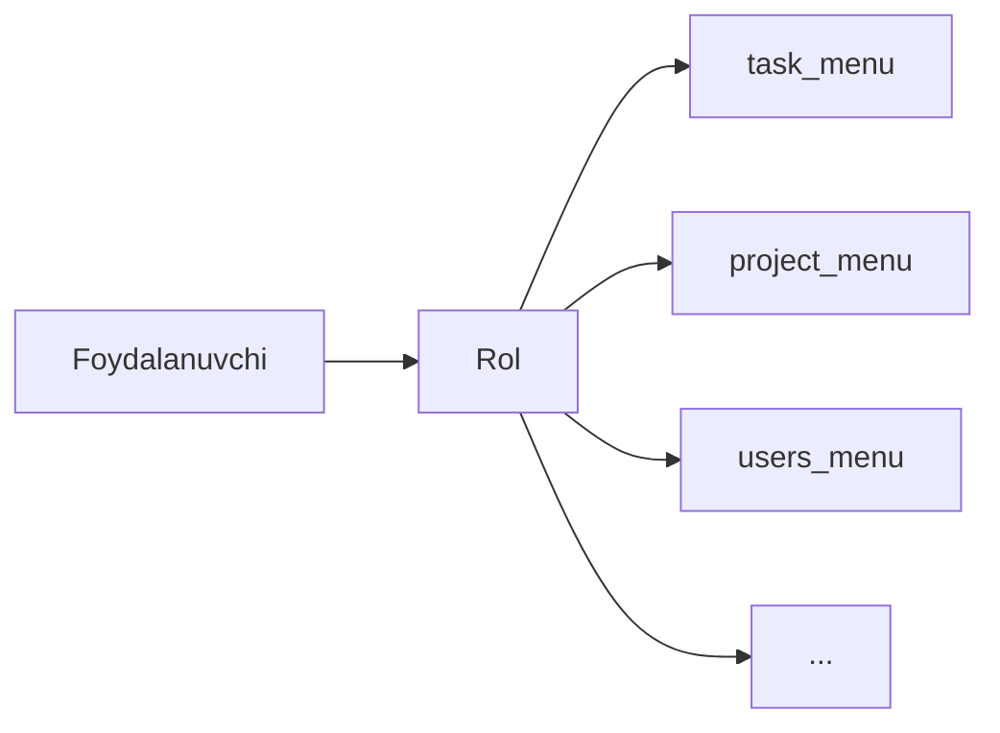
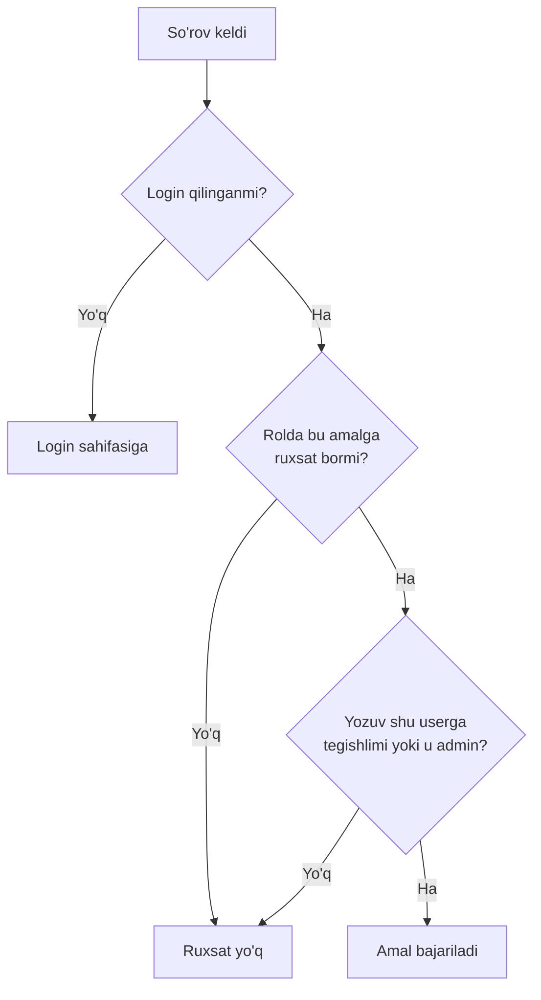

# Mini Trello

Loyihalar va vazifalarni boshqarish tizimi. Sof PHP, PDO va MySQL da, frameworksiz yozilgan.

Tizimda uch xil rol bor. **Admin** butun tizimni boshqaradi: foydalanuvchilar, rollar va ularning ruxsatlari. **Ish boshqaruvchi** o'z loyihalariga mas'ul, ularning holati va jamoasini kuzatadi. **Xodim** o'ziga biriktirilgan vazifalarni bajaradi. Har bir rolga ruxsatlar alohida biriktiriladi, shuning uchun har kim faqat o'ziga tegishli sahifa, tugma va ma'lumotlarni ko'radi.

**Asosiy imkoniyatlar:** login va sessiyalar, rol va ruxsatlar (RBAC), foydalanuvchilar, loyihalar va vazifalar uchun CRUD, qidiruv va filterlar, pagination, admin va ish boshqaruvchi uchun alohida dashboardlar.

**Texnologiyalar:** PHP 8, PDO, MySQL, Bootstrap 5.

---

## Ma'lumotlar bazasi



`role_permissions` bog'lovchi jadval: bitta rolda ko'p ruxsat, bitta ruxsat ko'p rolda bo'lishi mumkin.

## Rollar va ruxsatlar



Ruxsatlar kodga emas, bazaga yozilgan. Admin rolga yangi ruxsat bersa, u darhol kuchga kiradi, kodni o'zgartirish shart emas.

## So'rov qanday tekshiriladi



Uch bosqichli himoya: **kirganmi** (sessiya), **qila oladimi** (rol ruxsati), **aynan shu yozuv ustida qila oladimi** (egalik). Tekshiruvlar server tomonida bajariladi, interfeysda tugmalarni yashirish faqat qulaylik uchun.

## Ishga tushirish

```bash
composer install
php -S localhost:8000 -t public
```

`config/database.example.php` dan nusxa olib `config/database.php` yarating va baza ma'lumotlarini yozing.
